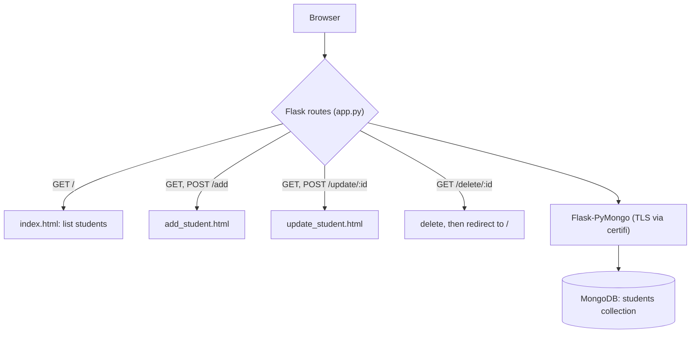
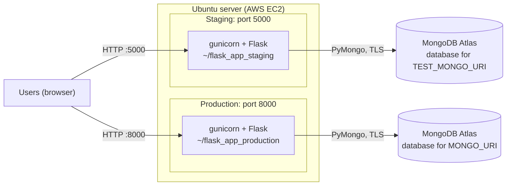
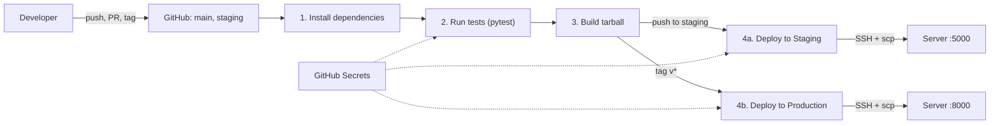
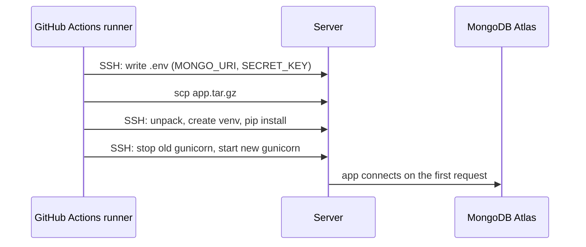

# Student Registration System

[](https://github.com/ankitrlambhate/flask_Practice/actions/workflows/flask-ci-cd.yml)

A simple **Flask** web application to manage student records with **MongoDB** as the backend database. Users can **add, view, update, and delete** student details.

The repository ships with a **GitHub Actions CI/CD pipeline** that installs dependencies, runs the tests, builds a release package and deploys it to a staging or production server over SSH.

---

## Table of Contents

* [Features](#features)
* [Tech Stack](#tech-stack)
* [Architecture](#architecture)
* [Project Structure](#project-structure)
* [Setup Instructions](#setup-instructions)
* [GitHub Actions CI/CD Pipeline](#github-actions-cicd-pipeline)
* [Jenkins CI/CD Pipeline](#jenkins-cicd-pipeline)
* [License](#license)

---

## Features

* List all students on the home page
* Add a new student
* Update existing student details
* Delete a student with confirmation
* Simple and responsive UI using Bootstrap

---

## Tech Stack

* **Backend:** Python, Flask (served by gunicorn on the servers)
* **Database:** MongoDB / MongoDB Atlas (via Flask-PyMongo)
* **Frontend:** HTML, Jinja2 templates, Bootstrap 5
* **Testing:** pytest
* **CI/CD:** GitHub Actions (also a Jenkinsfile)
* **Environment Variables:** Managed via `.env` file locally, GitHub Secrets in CI/CD

---

## Architecture

### Application



| Route | Methods | Purpose |
| --- | --- | --- |
| `/` | GET | List all students |
| `/add` | GET, POST | Show the form / create a student |
| `/update/<student_id>` | GET, POST | Show the pre-filled form / update a student |
| `/delete/<student_id>` | GET | Delete a student and return to the list |

### Deployment

Staging and production run side by side on one Ubuntu server (AWS EC2), each in its own folder and on its own port.



---

## Project Structure

```
flask_Practice/
│
├── .github/
│   └── workflows/
│       └── flask-ci-cd.yml      # GitHub Actions pipeline
│
├── templates/
│   ├── base.html
│   ├── index.html
│   ├── add_student.html
│   └── update_student.html
│
├── screenshot/                  # UI screenshots
├── app.py                       # Flask application
├── test_app.py                  # pytest tests
├── requirements.txt
├── Jenkinsfile                  # Jenkins pipeline
├── azure-pipelines.yml
├── start_flask.sh
└── .env                         # local only, never committed
```

---

## Setup Instructions

### 1. Clone the repository

```bash
git clone <your-repo-url>
cd <repo-folder>
```

### 2. Create and activate a virtual environment

```bash
python -m venv venv
# Activate venv
# Windows:
venv\Scripts\activate
# Linux / Mac:
source venv/bin/activate
```

### 3. Install dependencies

```bash
pip install -r requirements.txt
```

**`requirements.txt`:**

```
Flask
Flask-PyMongo
python-dotenv
pymongo
certifi
pytest
pylint
bandit
black
```

### 4. Configure environment variables

Create a `.env` file in the project root:

```
MONGO_URI=<your-mongodb-connection-string>
SECRET_KEY=<your-secret-key>
```

The connection string **must include a database name**, for example
`mongodb+srv://<user>:<password>@<cluster>.mongodb.net/studentDB?appName=Cluster0`.
Without it the home page fails with a `500` error.

> The app passes the `certifi` CA bundle to PyMongo, which turns TLS on. Use a MongoDB Atlas (`mongodb+srv://`) URI or another TLS-enabled MongoDB. A plain local `mongod` without TLS will not connect.

### 5. Run the application

```bash
python app.py
```

Open your browser at: [http://localhost:5000](http://localhost:5000)

### 6. Run the tests

```bash
python -m pytest test_app.py -v
```

> **Warning:** the tests delete every document in the `students` collection of the database in `MONGO_URI`. Always point tests at a throwaway database.

---

## GitHub Actions CI/CD Pipeline

The workflow [`.github/workflows/flask-ci-cd.yml`](.github/workflows/flask-ci-cd.yml) runs install, test and build for every push or pull request to `main` or `staging`, then deploys over SSH.



### Jobs

| Job | What it does | Runs when |
| --- | --- | --- |
| **Install dependencies** | Sets up Python 3.12 (with pip cache) and installs `requirements.txt` | every run |
| **Run tests** | Runs `pytest test_app.py -v` against MongoDB using the `TEST_MONGO_URI` secret | every run, after install |
| **Build** | Packages `app.py`, `requirements.txt` and `templates/` into `app.tar.gz` and uploads it as an artifact | only if tests pass |
| **Deploy to Staging** | Uploads the build to the server and restarts the staging app on port 5000 | push to the `staging` branch |
| **Deploy to Production** | Same, for production on port 8000 | push of a tag matching `v*` |

Pull requests and pushes to `main` run install, test and build only. They never deploy.

### Branches and releases

```bash
# deploy to staging: merge into the staging branch and push
git checkout staging
git merge main
git push origin staging

# deploy to production: tag a commit on main and push the tag
git checkout main && git pull
git tag v1.0.0
git push origin v1.0.0
```

The workflow file must exist on the branch or tag you push, because GitHub runs the version of the file from that commit.

### What a deploy does



On the server each environment lives in its own folder (`~/flask_app_staging`, `~/flask_app_production`) with a virtualenv, a `.env` file written from the secrets, and an `app.pid` file for the running gunicorn process.

### Configuring secrets

Go to **Settings → Secrets and variables → Actions → New repository secret** and add:

| Secret | Used by | What it is |
| --- | --- | --- |
| `TEST_MONGO_URI` | tests, staging deploy | MongoDB connection string for the test/staging database |
| `MONGO_URI` | production deploy | MongoDB connection string for production |
| `SECRET_KEY` | tests, deploys | Flask secret key (generate one with `python3 -c "import secrets; print(secrets.token_hex(32))"`) |
| `SSH_HOST` | deploys | Server public IP or hostname |
| `SSH_USER` | deploys | SSH login user (for example `ubuntu`) |
| `SSH_PRIVATE_KEY` | deploys | Private key of a deploy key pair, including the `BEGIN` and `END` lines |

Rules for the values:

* Paste only the value: no quotes, no `NAME=` prefix, no spaces or line breaks.
* Every MongoDB URI must start with `mongodb://` or `mongodb+srv://` and include a database name before the `?`.
* The tests wipe the `students` collection of `TEST_MONGO_URI`'s database on every run, and staging uses the same URI. Staging data is therefore reset by each pipeline run. Use a separate URI for staging if you want its data to persist.
* Secrets are hidden in logs, and pull requests from forks do not receive them.

Also create two **environments** under **Settings → Environments**, named exactly `staging` and `production`. Add **Required reviewers** to `production` if you want a manual approval before each release.

Create the deploy key and install it on the server:

```bash
ssh-keygen -t ed25519 -f deploy_key -N "" -C "github-actions"
ssh-copy-id -i deploy_key.pub <SSH_USER>@<SSH_HOST>
cat deploy_key        # paste the full output into the SSH_PRIVATE_KEY secret
```

Never commit `deploy_key`.

### Preparing the server

On an Ubuntu server (AWS EC2 example):

```bash
sudo apt update
sudo apt install -y python3 python3-venv python3-pip curl
```

* Open inbound TCP ports **5000** (staging) and **8000** (production) in the EC2 **Security group**, and in `ufw` if it is enabled.
* In MongoDB Atlas **Network Access**, allow the server's IP. Allow `0.0.0.0/0` for the GitHub-hosted test runner, whose IP changes on every run.

### Verifying a deployment

On the server:

```bash
curl -I http://127.0.0.1:5000/     # staging, expect HTTP 200
curl -I http://127.0.0.1:8000/     # production, expect HTTP 200
ps aux | grep '[g]unicorn'
```

From a browser: `http://<server-public-ip>:5000` (staging) and `http://<server-public-ip>:8000` (production). Add, update and delete a student to confirm the database connection works.

### Troubleshooting

| Symptom | Likely cause and fix |
| --- | --- |
| `ensurepip is not available` during deploy | Install the venv package: `sudo apt install -y python3-venv`, then `rm -rf ~/flask_app_*/venv` and re-run |
| Deploy job is green but nothing is listening | gunicorn failed to start and its output is not saved. Run it in the foreground to see the error: `cd ~/flask_app_staging && venv/bin/gunicorn -b 0.0.0.0:5000 app:app` |
| `Invalid URI scheme: URI must begin with 'mongodb://'` | The secret is empty or malformed, or the wrong secret name is used. Check the secret value and the `.env` on the server |
| Home page returns `500` | The URI has no database name, Atlas is blocking the server's IP, or the credentials are wrong |
| Browser says "site can't be reached" / times out | Ports 5000 / 8000 are not open in the security group or firewall |
| Staging deploy does not start after a push | The push must be to the `staging` branch, and `flask-ci-cd.yml` must exist on that branch |
| Production deploy does not start | Push a **new** tag starting with `v` from a commit that has the fixed workflow. Re-running an old tag uses the old file |

### Limitations

* No automatic rollback: a bad deploy is not reverted.
* The deploy does not check that the app came up. A green job only means the commands ran, so verify as shown above.
* gunicorn runs as a background process, not a systemd service, so it does not restart after a server reboot.

---

## Jenkins CI/CD Pipeline

This repository also includes a Jenkins pipeline for running a build, unit tests, and a staging deployment whenever code is pushed to the `main` branch.

### Pipeline stages

1. Build
   - Creates a Python virtual environment
   - Upgrades `pip`
   - Installs dependencies from `requirements.txt`

2. Test
   - Runs `pytest -q` against the project tests

3. Deploy
   - Copies the project into `/opt/flask_practice`
   - Starts the Flask application in the background using `nohup`
   - Runs only on the `main` branch

### Prerequisites

- Jenkins installed on a machine or VM
- Java runtime installed with Jenkins
- Python 3 and `pip` available on the Jenkins agent
- Git installed
- GitHub repository connected to Jenkins
- Required Jenkins plugins:
  - GitHub Integration / GitHub plugin
  - Pipeline
  - Email Extension plugin (optional but required for email notifications)
- MongoDB running and accessible via the app's `.env` configuration

### Jenkins setup steps

1. Install Jenkins and open the Jenkins dashboard.
2. Install the required plugins.
3. Create a new pipeline job.
4. Point the pipeline to this repository.
5. Use the repository's `Jenkinsfile`.
6. Enable GitHub hook or configure polling for the `main` branch.
7. Save the job and trigger a build.

### GitHub trigger configuration

To trigger builds when changes are pushed to `main`, configure either:

- a GitHub webhook, or
- Jenkins polling for the repository branch

The `Jenkinsfile` includes:

```groovy
triggers {
    githubPush()
}
```

This works when GitHub integration is enabled and the repo is linked to Jenkins.

### Email notifications

The pipeline uses the Jenkins `mail` step to send build status notifications on success and failure.

Update the recipient email in the `Jenkinsfile` before running it in production:

```groovy
mail to: 'ankit@example.com'
```

### Notes

* Make sure MongoDB is running and accessible via the URI in `.env`
* Delete action includes a confirmation page to prevent accidental deletion
* Uses `ObjectId` from `bson` to work with MongoDB document IDs
* If you use MongoDB Atlas on macOS, install dependencies again (`pip install -r requirements.txt`). This project uses the `certifi` CA bundle explicitly to avoid common TLS certificate verification failures with `pymongo`.
* For production deployments, replace the simple `nohup` staging deploy step with a proper systemd service, Docker deployment, or another deployment strategy.

---

## License

MIT License

---
